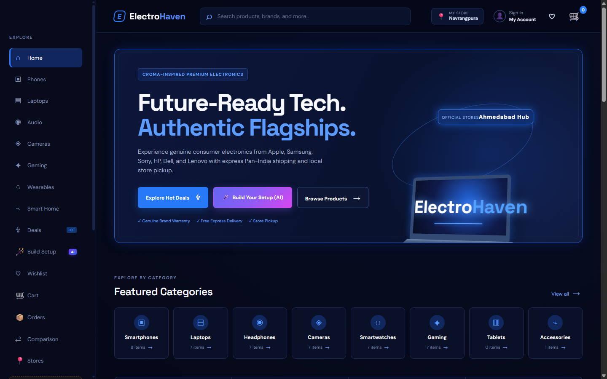
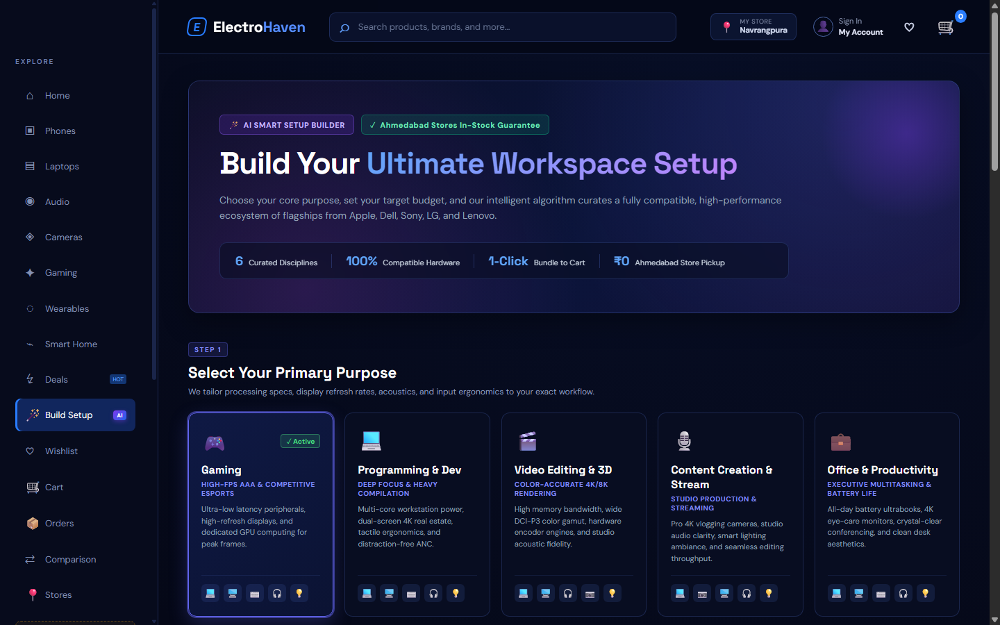
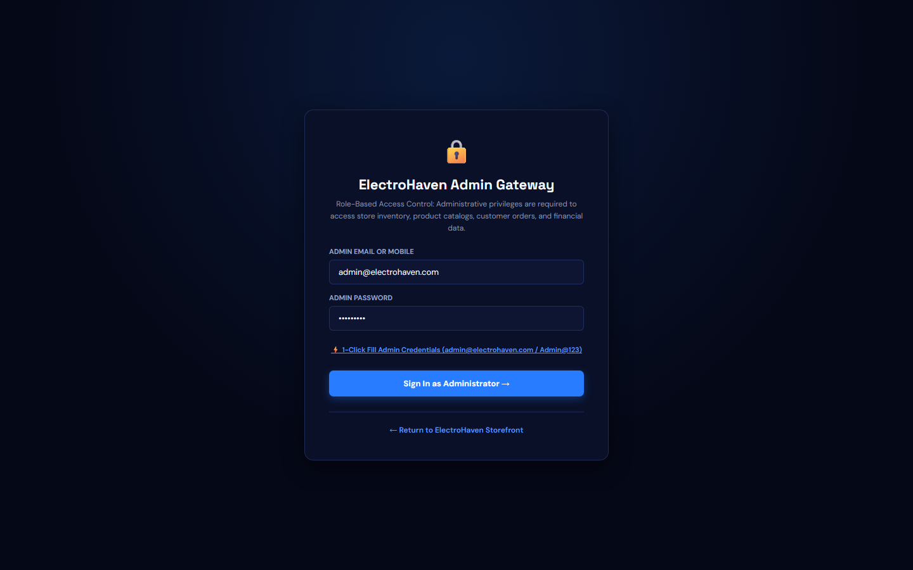
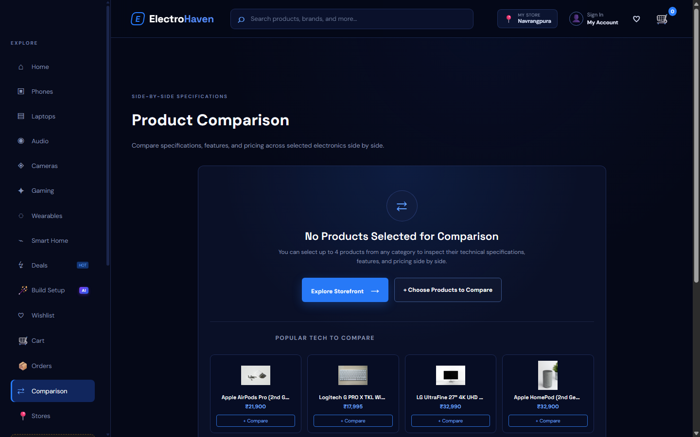
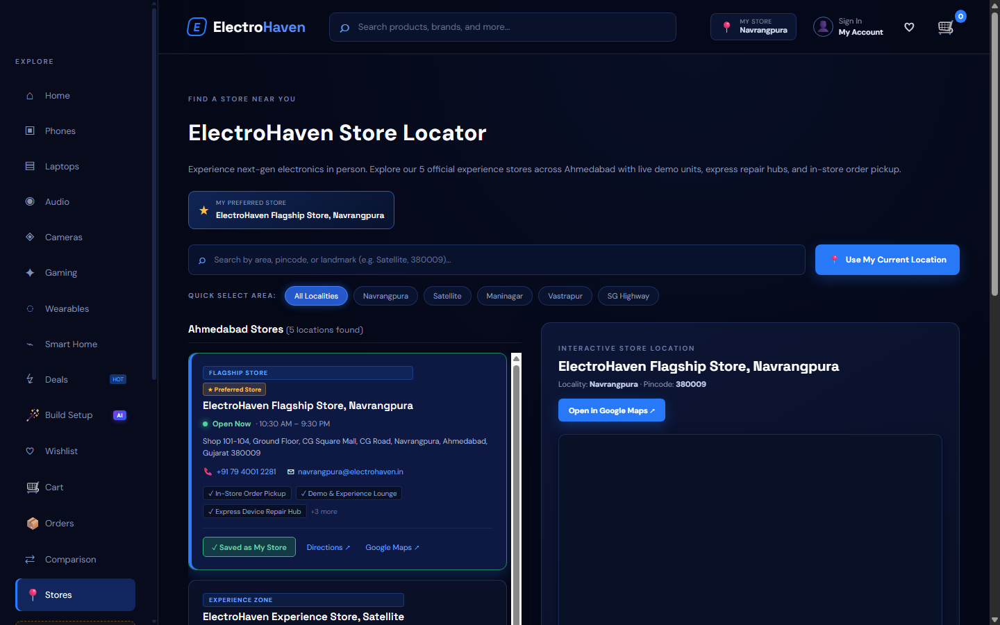

# ElectroHaven — Next-Gen Electronics E-Commerce Platform

[](https://react.dev/)
[](https://vitejs.dev/)
[](package.json)
[](scripts/)
[](src/App.css)

> **Croma-inspired flagship electronics storefront** engineered for lightning-fast performance, client-side real-time synchronization, intelligent workspace recommendations, and seamless store pickup.

---

## 🌟 Overview

**ElectroHaven** is a full-featured consumer electronics shopping platform built with **React 18** and **Vite**. Inspired by premium retail platforms like Croma and Apple Storefronts, it pairs high-fidelity visual design with deep e-commerce capabilities:

- **AI Smart Setup Builder**: Algorithmic workspace curation across 6 disciplines (Gaming, Programming, Office, Video Editing, Content Creation, and Study) strictly within the user's budget.
- **Click & Collect (Store Pickup)**: 5 Ahmedabad flagship store locations with real-time per-store stock validation, 4-stage pickup status progression, and unique pickup security passes.
- **Visual Order Tracking & Cancellation**: Croma-style visual milestone tracking (`Order Placed` ➔ `Confirmed` ➔ `Packed` ➔ `Shipped` ➔ `Out for Delivery` ➔ `Delivered`) with automated stock restoration upon cancellation.
- **Real-Time Cross-Tab Sync**: Instant reactive synchronization across customer tabs and admin panels using `BroadcastChannel` and storage events with zero page reloads.
- **Comprehensive Admin Dashboard**: Full product catalog CRUD, store inventory matrix management, user suspension controls, order lifecycle processing, and dynamic discount coupons.
- **Cryptographic Security**: Client-side PBKDF2 password derivation with cryptographically random salts using the browser's native **WebCrypto API**.
- **Adaptive Dual Themes**: Fully customized Dark Mode (glassmorphic deep navy) and crisp Light Mode with instantaneous theme toggling.

---

## 📸 Screenshots

| 🛒 Storefront & Flagship Catalog | 🪄 AI Smart Setup Builder |
| :---: | :---: |
|  |  |
| *Authentic electronics from Apple, Samsung, Sony, HP, Dell, and Lenovo.* | *Multi-tier budget setups with real-time swapping and 1-click cart bundling.* |

| ⚙️ Professional Admin Dashboard | ⇄ Product Comparison Engine |
| :---: | :---: |
|  |  |
| *Real-time order lifecycle, store stock overrides, and user management.* | *Side-by-side technical specification matrix across top flagships.* |

| 🏬 Ahmedabad Click & Collect Store Locator |
| :---: |
|  |
| *Real-time store availability across 5 retail hubs with express 2-hour pickup.* |

---

## 🚀 Key Features

### 1. 🪄 AI Smart Setup Builder
- **6 Tailored Purposes**:
  - 🎮 **Gaming**: GeForce RTX laptops, 240Hz Quantum Mini-LED curved displays, magnetic actuation keyboards, and 360 Spatial Audio.
  - 💻 **Programming & Dev**: High-throughput multi-core laptops, 4K eye-care monitors, tactile switches, and dual-processor ANC headphones.
  - 🎬 **Video Editing & 3D**: ProRes hardware encoders, 98% DCI-P3 color-calibrated monitors, and studio reference monitoring.
  - 🎙️ **Content Creation & Streaming**: APS-C 4K creator cameras, ambient three-point lighting, and rapid video export pipeline.
  - 💼 **Office & Productivity**: All-day battery ultrabooks, 27" USB-C single-cable power hubs, and beamforming conference microphones.
  - 📚 **Study & Academics**: Fanless portable ultrabooks, in-ear library buds, and wellness recovery tracking.
- **Multi-Tier Recommendations**: Generates **Smart Value (Budget)**, **Recommended Sweet Spot (Balanced)**, and **Peak Performance** tiers.
- **Strict Budget Guarantee**: Algorithmic cost optimization ensures the recommended bundle strictly stays $\le$ your budget.
- **Live Component Swapping**: Replace any individual product (core machine, display, keyboard, audio, camera) and instantly view updated totals and savings.
- **1-Click Cart Bundling**: Add all items in the setup to the cart with one click.

### 2. 🏬 Store Pickup / Click & Collect
- Choose **Store Pickup (Free · 2 Hours)** or **Express Pan-India Delivery** during checkout.
- Real-time stock checks across **5 Ahmedabad retail locations**:
  - *Navrangpura Flagship Experience Centre*
  - *Satellite Retail Hub*
  - *Maninagar Tech Hub*
  - *Vastrapur Mega Store*
  - *SG Highway Tech Experience Lounge*
- Orders with Store Pickup generate a verified 4-digit pickup code (`EH-PASS-XXXX`) and provide Google Maps directions.

### 3. 📦 Real-Time Order Tracking & Cancellation
- Visual tracking timeline with live progress bars.
- Courier partner details and copyable Air Waybill (AWB) numbers.
- Self-service cancellation before dispatch with automated store inventory restoration.
- Real-time administrative status updates (`Preparing` ➔ `Ready for Pickup` ➔ `Collected`).

### 4. 🛡️ Secure Authentication & Roles
- **Registration & Sign In**: Full validation, password strength meter, and show/hide password toggling.
- **PBKDF2 Cryptographic Hashing**: 100,000 iterations of HMAC-SHA256 with unique 16-byte random salts.
- **Role-Based Access Control**: Strict route guarding preventing unauthorized access to the Admin Dashboard.
- **Session Persistence**: Session stays active across refreshes and tab reloads.

### 5. ⚡ Real-Time Admin Synchronization
- Instant synchronization between Admin Dashboard and Customer storefronts without manual page refreshes.
- Modifying product prices, adding products, updating inventory, or changing order statuses reflects across all open client tabs instantly.

---

## 🛠️ Technology Stack

| Layer | Technologies |
| :--- | :--- |
| **Frontend Framework** | React 18 (`react`, `react-dom`) |
| **Build & Tooling** | Vite 5 (`vite`, `@vitejs/plugin-react`) |
| **Styling & Design** | Modern CSS3 (CSS Custom Properties, Glassmorphism, Radial Gradients, KaTeX support) |
| **Cryptography** | Browser Native WebCrypto API (PBKDF2, HMAC-SHA256) |
| **Real-Time Engine** | `BroadcastChannel` API + `StorageEvent` Pub/Sub Relay |
| **Routing** | Client-Side Hash Router (`#/build-setup`, `#/product/:id`, `#/admin`, etc.) with `sessionStorage` fallback |
| **State Persistence** | LocalStorage persistence with data validation & schema migration |

---

## 💻 Getting Started

### Prerequisites
- **Node.js**: `v18.0.0` or higher
- **npm**: `v9.0.0` or higher (or `pnpm` / `yarn`)

### Installation Steps

1. **Clone the repository:**
   ```bash
   git clone https://github.com/your-username/electrohaven.git
   cd electrohaven
   ```

2. **Install dependencies:**
   ```bash
   npm install
   ```

3. **Set up environment variables:**
   ```bash
   cp .env.example .env
   ```
   *(Optional: ElectroHaven runs fully out of the box with zero external configuration!)*

4. **Start the local development server:**
   ```bash
   npm run dev
   ```
   Open [http://localhost:5173](http://localhost:5173) in your browser.

5. **Run automated test suites:**
   ```bash
   npm test
   ```

6. **Create a production build:**
   ```bash
   npm run build
   ```

7. **Preview the production build locally:**
   ```bash
   npm run preview
   ```

---

## 🔑 Demo Accounts

For testing authentication, permissions, and administrative workflows, use the pre-configured demo credentials:

| Role | Email / Username | Password | Access Capabilities |
| :--- | :--- | :--- | :--- |
| **Master Admin** | `admin@electrohaven.com` | `Admin@123` | Full Admin Dashboard, Catalog CRUD, Inventory, Orders, User Suspension |
| **Customer** | `alex.sharma@example.com` | `Password@123` | Storefront, Setup Builder, Wishlist, Cart & Checkout, Order Tracking |

---

## 📁 Project Structure

```text
electrohaven/
├── .env.example              # Sample environment configuration template
├── .gitignore                # Production git exclusion patterns
├── CHANGELOG.md              # Version and feature release history
├── CONTRIBUTING.md           # Guidelines for contributing to ElectroHaven
├── LICENSE                   # Open-source licensing information
├── README.md                 # Project documentation & overview
├── index.html                # Vite HTML entry point
├── package.json              # Package manifest, dependencies, and test scripts
├── public/
│   ├── favicon.svg           # Branded vector favicon
│   └── products/             # Authentic product photography assets
├── screenshots/              # High-resolution screenshots for documentation
├── scripts/
│   ├── capture_screenshots.js # Headless Chrome screenshot automation
│   ├── test_admin.js         # Admin CRUD & security verification suite
│   └── test_setup_builder.js # Setup builder algorithm verification suite
└── src/
    ├── AdminDashboard.css    # Admin portal dark/light styling
    ├── AdminDashboard.jsx    # Complete administrative management suite
    ├── App.css               # Main storefront and UI component stylesheets
    ├── App.jsx               # Application root, routing tree, and state orchestrator
    ├── AuthPage.jsx          # Login, Registration, and Forgot Password UI
    ├── CartPage.jsx          # Cart management with dynamic coupon discounts
    ├── CheckoutPage.jsx      # Multi-step checkout with Store Pickup selection
    ├── ComparisonPage.jsx    # Side-by-side product comparison engine
    ├── OrderConfirmationPage.jsx # Order summary and Click & Collect pickup pass
    ├── OrdersHistoryPage.jsx # Customer order history & real-time tracking
    ├── OrderTrackingModal.jsx# Croma-style visual progress timeline modal
    ├── PincodeDeliveryChecker.jsx # Indian 6-digit PIN delivery validator
    ├── ProductDetailPage.jsx # Rich product specs, reviews, and store inventory
    ├── SearchBar.jsx         # Live search bar with instant autocomplete
    ├── SearchResultsPage.jsx # Filtered search results view
    ├── SetupBuilderPage.jsx  # AI Smart Setup Builder interface
    ├── StoreLocatorPage.jsx  # Ahmedabad retail store locator and stock map
    ├── UserProfilePage.jsx   # Customer account management & address book
    ├── adminData.js          # Admin data layer and order lifecycle transitions
    ├── auth.js               # PBKDF2 WebCrypto authentication & sessions
    ├── cart.js               # Shopping cart storage & calculations
    ├── currency.js           # Indian Rupee (INR) currency formatter
    ├── data.js               # Catalog dataset and navigation taxonomy
    ├── imageUtils.js         # Image error handling & fallback placeholders
    ├── pincodeData.js        # Indian delivery pincode serviceability matrix
    ├── productDetailsData.js # Technical specifications and feature bullet points
    ├── realtimeSync.js       # BroadcastChannel pub/sub and cross-tab synchronizer
    ├── router.js             # Client-side router with state persistence
    ├── searchUtils.js        # Multi-attribute search and fuzzy filtering
    ├── setupBuilderEngine.js # Algorithmic setup generation and budget optimizer
    ├── storeAvailability.js  # Store stock allocation and distance matrix
    └── storesData.js         # Ahmedabad store coordinates and contact details
```

---

## 🌐 Deployment Guide

### Vercel (Recommended)
1. Push your repository to GitHub.
2. Import the project into the [Vercel Dashboard](https://vercel.com/).
3. Framework Preset: **Vite**.
4. Root Directory: `./`.
5. Build Command: `npm run build`.
6. Output Directory: `dist`.
7. Click **Deploy**.

### Netlify
1. Connect your repository on [Netlify](https://www.netlify.com/).
2. Build Command: `npm run build`.
3. Publish Directory: `dist`.
4. Add a `_redirects` file in `public/` containing `/* /index.html 200` to support client-side routing.
5. Deploy site.

### GitHub Pages
1. In `vite.config.js`, set `base: '/<repository-name>/'`.
2. Configure a GitHub Actions workflow using `.github/workflows/deploy.yml` with `actions/deploy-pages`.

---

## 🤝 Contributing

We welcome community contributions, bug reports, and feature suggestions! Please read our [CONTRIBUTING.md](CONTRIBUTING.md) guide for setup instructions, commit conventions, and pull request workflows.

---

## 📄 License

This project is licensed under the terms of the MIT License. See [LICENSE](LICENSE) for details.
*(Subject to confirmation by repository owner).*
